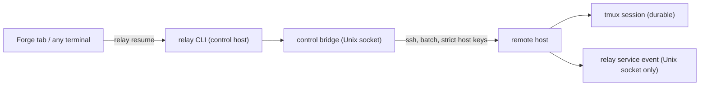

# relay

**Durable remote sessions for agent work** — SSH + tmux on a fleet host, one
authoritative home service, and a small stateless CLI other programs can drive
with `--json`.

Remote coding agents must survive laptop sleep, wifi drops, and closed windows,
and come back as the *same* session. relay creates, names, and re-attaches that
long-lived remote work. It has no window of its own: any terminal can present a
session by running `relay resume`, and [Forge](https://github.com/dostos/forge)
(a private Ghostty fork) does exactly that per tab.

**Status:** active · Go · macOS control host (launchd) + Linux remotes (systemd)
**Links:** [Forge](https://github.com/dostos/forge) (presenter, private) · [Design archive](docs/archive/README.md) · [Dev containers](docs/devcontainers.md)

## Install

Requires Go (see `go.mod`), `ssh`, and `tmux` on the remotes.

```bash
git clone https://github.com/dostos/relay.git
cd relay
./install.sh          # builds into ~/.local/bin/relay{,d}, then relay agents install
relay doctor --json
relay fleet upgrade   # same build on every known host + agent guidance there
```

Forge finds `relay` at `~/.local/bin/relay` (or `$FORGE_RELAY`).

## Quick start

```bash
relay host init -H HOST --apply                       # one-time per remote

relay HOST NAME                                       # this terminal → named remote tmux
relay session create -H HOST --name work -- claude    # any CLI as the pane's command
relay session adopt -H HOST --name my-tmux            # or adopt an existing tmux session

relay resume list                                     # live | disconnected | cleaned
relay resume --session NAME --host HOST               # attach; retries on SSH drop
```

## Usage

**An agent that survives closing the window.** Start Claude / Codex /
cursor-agent on a lab box, close the tab, sleep the laptop, and reattach later:

```bash
relay session create -H host-a --name eval -- cursor-agent "fix the flaky eval; keep tests green"
relay resume --session eval --host host-a      # from any pane, later
```

**Several durable remotes as one workspace.** Forge reads the JSON list:

```bash
relay session adopt -H host-a --name train
relay session adopt -H host-b --name eval
relay --json session list
```

**Chaining from inside a session.** A session started with `relay HOST NAME`
carries a reverse Unix-socket bridge to the control host, so `relay host-b followup`
run *inside* `host-a/research` is executed by the control plane — the remote never
gets the control host's credentials.

**Bring a new machine online.**

```bash
relay targets --json
relay host discover -H host-a --json
relay host init -H host-a --apply   # installs relay + compatibility symlink
```

### CLI map

```text
relay targets / host discover / host init   # new machine
relay HOST NAME                             # named tmux, attached in this terminal
relay session … / session adopt             # durable tmux (create takes -- ARGV)
relay session send|submit ID                # receipt: submitted | queued | deposited | uncertain (67) | not_sent
relay session wait ID --idle                # wait for the peer's reply (0 idle, 65 gate, 66 gone, 124 timeout)
                                            # ID = sess-… | HOST/NAME | unique NAME
relay session exec ID --detach / session op # durable ops: status/wait by cursor, survive SSH loss
relay container up|down|status|stop|start   # devcontainer or image-backed instance
relay auth status|login|copy                # agent CLI logins on a host
relay service run|status                    # unified home service and component health
relay resume --session NAME --host HOST     # what a Forge tab runs
relay pane classify / session readiness     # agent readiness for presenters
relay capabilities [-H HOST] --json         # installed client + host service build and features
relay fleet status|upgrade|report           # every known host: build drift, rollout, usage
relay agents install|status|doctor          # relay skill/AGENTS.md for Claude Code, ccs, Codex, cursor-agent
relay report --since 24h --json             # this machine's send/wait outcomes + findings
relay CMD --help · relay help exit-codes    # per-command flags and examples
```

Merged source and installed binaries can differ. Before relying on a feature,
automation should check `relay --json capabilities -H HOST`: it lists what the
installed client and the host's event service each report (for example
`session.submit`, `session.op.wait`), with `missing_on_daemon` /
`missing_on_client`. A service too old to report is `unreported`, a failed
probe is `unknown`; neither borrows the client's list. Host reports are cached
for five minutes per client build (`--refresh` to re-probe), and every
identity carries a `cache_key`.

## Architecture



relay owns sessions only. What a human looks at is the terminal's job (Forge);
delegated, machine-judged work is blacksmith's.

## Repository layout

| Path | Responsibility |
|---|---|
| `cmd/relay` | `relay` CLI entry point |
| `cmd/relayd` | Deprecated argv-compatibility shim for `relay`; the home service is `relay service run` (`internal/homeservice`) |
| `internal/` | Packages: `cli`, `core` (sessions, readiness), `controlbridge` and `bridge`, `homeservice`, `transport`, `persist`, `selfupdate`, others |
| `share/` | `host.yaml.example`, launchd and systemd units |
| `scripts/` | `cutover-unified-service.sh`, `verify-unified-service.sh` |
| `install.sh` | Binary and service bootstrap |

## Docs

- [Architecture and control bridge](docs/architecture.md) — layers, bridge security, resume states
- [Readiness for presenters](docs/readiness.md) — `ready / blocked / absent / gone / unknown`
- [Send receipts and durable operations](docs/session-send-and-ops.md) — addressing, fresh-turn/queued confirmation, composer guard, `wait --idle`, idempotency keys, detached sends, `exec --detach` + cursor waits
- [Fleet, usage report and agent CLIs](docs/fleet-and-agents.md) — `relay fleet`, `relay report`, `relay agents`, the daily review loop
- [Dev containers on a fleet host](docs/devcontainers.md)
- [Ghostty-native app design](docs/2026-09-05-ghostty-native-app-design.md)
- [Archive](docs/archive/README.md) — retired cmux presenter and delegation surface ([founding design](docs/archive/2026-07-24-relay-design.md))

## Development and testing

```bash
go test ./...
go build -o bin/relay ./cmd/relay
./install.sh
```

## License

No license file has been added yet.
